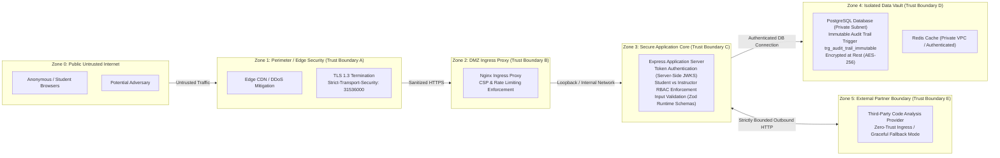

# StudySync System Architecture & Trust Boundaries (Requirement Q2)

## 1. Request Path Diagram

The diagram below details the end-to-end request lifecycle from the client browser through DNS, CDN edge caching, container ingress, application runtime, datastore, and third-party integrations.

```mermaid
flowchart TD
    subgraph Client["Client Tier"]
        Browser["User Browser (React + TS SPA)"]
    end

    subgraph Edge["DNS & CDN Edge Tier (Cloudflare / Edge CDN)"]
        DNS["Authoritative DNS (studysync.edu)\nCAA Record Enforced | TTL 300s"]
        CDN["Edge CDN Ingress\nHTTPS Termination (TLS 1.3)\nCache Layer: Hashed Assets (1yr), HTML (no-cache)"]
    end

    subgraph DMZ["Container Ingress / Reverse Proxy Tier"]
        Nginx["Nginx Reverse Proxy (:80 / :443)\nSecurity Headers (HSTS, CSP, X-Frame-Options)\nReverse Proxy /api/* & /healthz"]
    end

    subgraph AppTier["Application Compute Tier"]
        Backend["StudySync Express Server (:4000)\nOpenTelemetry Tracing & Metrics\nJWT JWKS Validator & Role Authorizer\nSliding Window Rate Limiter"]
        SSEBus["SSE Monotonic Event Bus\nCircular Replay Buffer (500 items)"]
        MCP["MCP Server (:4000/api/v1/mcp)\nJSON-RPC 2.0 Handler\nOAuth Scopes: studysync:read / write"]
    end

    subgraph DataTier["Persistent Datastore Tier"]
        Postgres[("PostgreSQL 16 Storage\nRelational Schema & 3 Justified Indexes\nSchema Migrations & Immutable Audit Trail")]
        Redis[("Redis 7 Cache & State\nSliding Window Counters & TTL Auth State\nUpstream Analysis Cache (300s TTL)")]
    end

    subgraph ExternalTier["External Integrations (Untrusted Outer Boundary)"]
        OIDCProvider["OIDC / OAuth Identity Provider\nAuthorization Code + PKCE (S256)\nRemote JWKS Key Endpoint"]
        AnalyzerAPI["Third-Party Code Analysis API\nCircuit Breaker, 2000ms Timeout, Bounded Retries"]
    end

    Browser -->|1. HTTPS Query| DNS
    DNS -->|2. Resolved IP| CDN
    CDN -->|3. Cached Static Assets| Browser
    CDN -->|4. Dynamic API Requests (MISS)| Nginx
    Nginx -->|5. Forward with X-Forwarded-For| Backend
    Backend <-->|6. Publish / Subscribe| SSEBus
    Backend <-->|7. Tool Execution| MCP
    Backend <-->|8. Prepared SQL Queries| Postgres
    Backend <-->|9. Rate Limiting & Auth State| Redis
    Backend <-->|10. JWKS Fetch & Token Verify| OIDCProvider
    Backend <-->|11. Resilient HTTP (Bounded Retry)| AnalyzerAPI
    SSEBus -.->|12. text/event-stream Live Updates| Browser
```

---

## 2. Trust Boundaries & Security Zones



### Trust Boundary Analysis
1. **Trust Boundary A (Internet to Edge CDN)**:
   - Untrusted public clients communicate strictly over HTTPS (TLS 1.3) with automated CAA record validation and HSTS.
   - Malicious DDoS floods and malformed HTTP traffic are scrubbed at the edge.
2. **Trust Boundary B (CDN to Ingress Proxy)**:
   - Ingress Nginx strictly accepts traffic forwarded with verified headers (`X-Forwarded-For`, `X-Forwarded-Proto`).
   - Caching rules prevent any personalized or authenticated response from being shared-cached (`Cache-Control: private, no-store`).
3. **Trust Boundary C (Ingress to Application Core)**:
   - User identity is NEVER trusted from client claims, headers, or body inputs.
   - All authorization tokens are cryptographically verified server-side against provider JWKS (`iss`, `aud`, `exp`, `sig`, `scope`).
   - Role boundaries (`student` vs. `instructor` vs. `admin`) are verified on every write mutation with 401/403 rejections.
4. **Trust Boundary D (Application Core to Datastore)**:
   - Database resides in an isolated internal subnet with strict firewall controls.
   - Audit trail records are protected by database-level triggers (`trg_audit_trail_immutable`) preventing `UPDATE` and `DELETE` even if an application SQL query were compromised.
5. **Trust Boundary E (Application Core to External Third-Party API)**:
   - Outbound connections are treated with zero-trust: strict 2000ms timeout, maximum 3 bounded exponential retries, response payload validated at runtime via Zod schema, and fallback to graceful degradation if the vendor becomes unresponsive.

